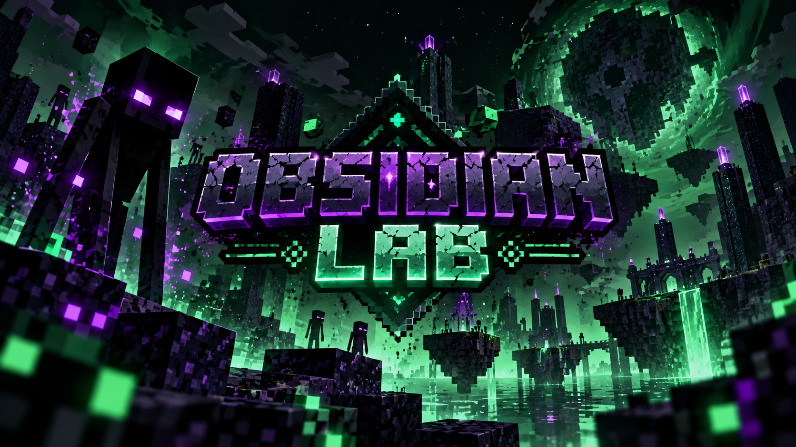

  

# ⛏️ OBSIDIAN LAB

**Minecraft Mod Ports & Fabric Compatibility Patches**

> Breaking version barriers, one patch at a time

## 🟢 About

unofficial minecraft java edition mod ports, compatibility patches, and experimental builds

## 📦 Projects

| mod | minecraft | loader | status |
|---|---|---|---|
| no projects published yet | — | fabric | planned |

## 🧪 Testing status

- `planned` — no build available yet
- `experimental` — build exists, testing incomplete
- `tested` — documented tests passed
- `working` — main features confirmed in the documented environment
- `broken` — known issue prevents intended use

## 📥 Downloads

check the releases page for available builds

## ⚙️ compatibility

each project documents its minecraft version, fabric loader, dependencies, test environment, and known issues

## ⚖️ Credits & licensing

original mods remain the property of their respective authors. modified binaries are redistributed only when permitted by the applicable license or explicit permission. otherwise, only permitted patches or source changes may be provided

## ⚠️ Disclaimer

this is an unofficial community project and is not affiliated with mojang studios or microsoft

---

built with curiosity, tested block by block
